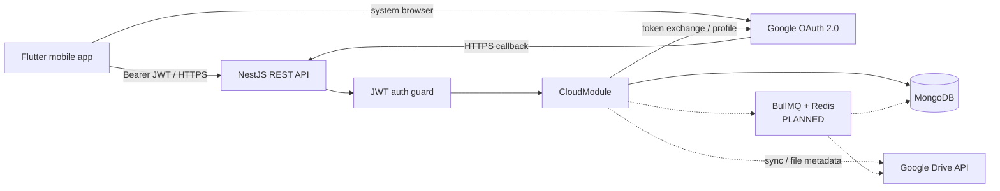
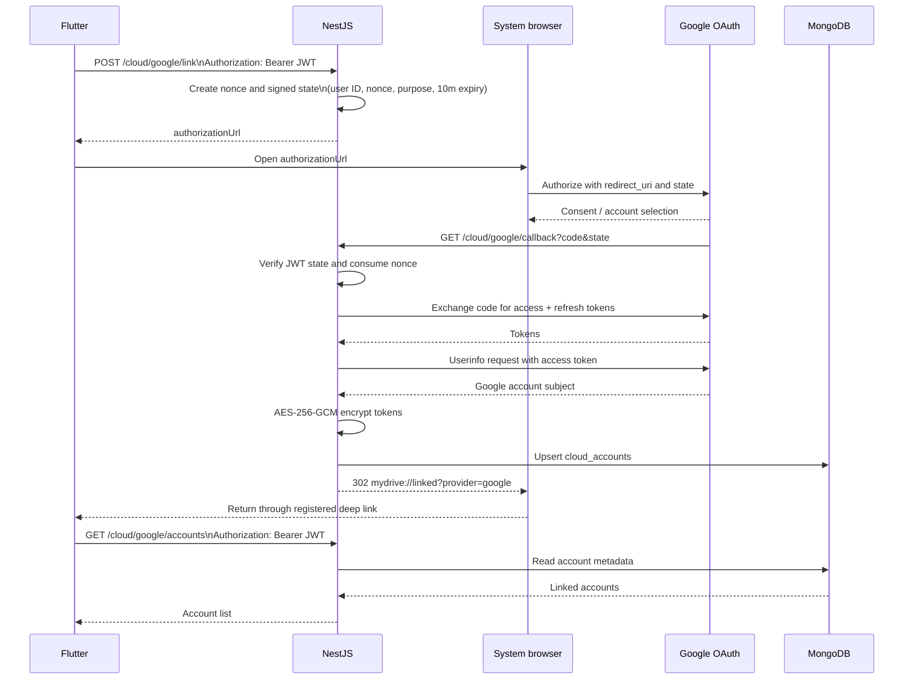
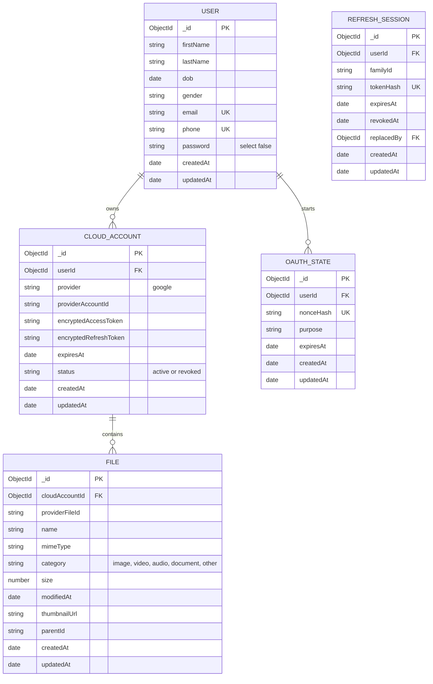

# My Drive Backend Architecture

## 1. System overview

My Drive uses a Flutter client, a NestJS REST API, MongoDB, and Google OAuth 2.0. The user authenticates to My Drive with a JWT. Google Drive linking is a separate delegated-access flow owned by the backend; Flutter never receives or stores Google tokens.



The current implementation covers registration, login, profile operations, logout, Google account linking, account listing, unlinking, encryption, the OAuth state store, and the file schema. File synchronization, file APIs, provider refresh, Redis, and BullMQ are planned.

## 2. Module and responsibility map

| Module or file | Responsibility | Status |
|---|---|---|
| `UserModule` | User schema, registration, login, profile update, JWT creation, refresh sessions, guard, blacklist | IMPLEMENTED |
| `UserController` | `/user/*` routes | IMPLEMENTED |
| `JwtAuthGuard` | Validates `Authorization: Bearer <token>` and checks the blacklist | IMPLEMENTED |
| `TokenBlacklistService` | In-memory revoked-token set | IMPLEMENTED, single-instance only |
| `CloudModule` | Cloud controller, service, account and file models | IMPLEMENTED |
| `CloudController` | Google link, callback, account listing, unlink | IMPLEMENTED |
| `CloudService` | OAuth URL, state, code exchange, profile lookup, encrypted token persistence | IMPLEMENTED |
| `TokenEncryptionService` | Versioned AES-256-GCM encryption/decryption for provider tokens | IMPLEMENTED |
| `oauth_states` | Hashed, expiring, single-use OAuth state nonces | IMPLEMENTED |
| `refresh_sessions` | Hashed rotating refresh tokens and token families | IMPLEMENTED |
| `cloud_accounts` | One linked provider account per user/provider | IMPLEMENTED |
| `files` | Normalized provider file metadata | SCHEMA IMPLEMENTED; population PLANNED |
| Sync processors | Initial and incremental synchronization | PLANNED |
| Dropbox/Jio providers | Additional provider adapters | PLANNED |

The current cloud implementation calls Google through native `fetch`; it does not yet expose a provider interface or provider adapter classes.

## 3. Authentication design

### Endpoints

| Operation | Method and path | Auth |
|---|---|---|
| Register | `POST /user/create-user` | Public |
| Login | `POST /user/login-user` | Public |
| Current profile | `GET /user/details` | JWT |
| Edit profile | `PATCH /user/update-user` | JWT |
| Logout | `POST /user/logout` | JWT |

Registration accepts `firstName`, `lastName`, `dob`, `gender`, `email`, `phone`, `password`, and `conf_password`. Login accepts `username` (email or phone) and `password`.

Passwords are hashed with bcrypt. The JWT payload contains `sub` (user ID) and `email`. Access JWTs expire after 15 minutes. Refresh tokens are opaque 64-byte random values, returned only at registration/login/refresh time, and stored in MongoDB only as SHA-256 hashes. Refresh tokens expire after `REFRESH_TOKEN_TTL_DAYS` (30 by default).

`POST /auth/refresh` accepts a refresh token, atomically revokes the presented token, creates a replacement in the same token family, and returns a new access/refresh pair. If a previously rotated token is presented again, the whole family is revoked and the request fails with `401 refresh token reuse detected`.

Logout adds the presented access token to `TokenBlacklistService` and revokes all refresh sessions for the user. The access-token blacklist is in process memory: it invalidates the token on the current instance until restart, but is not shared across instances and has no TTL cleanup.

## 4. Cloud-linking design

The user first authenticates to My Drive. `POST /cloud/google/link` requires the My Drive JWT and returns a Google authorization URL. The Google callback is public because Google calls it directly; the signed state binds the callback to the original My Drive user.



The nonce store is MongoDB-backed, so the link request and callback can reach different API instances. Expired records are removed by MongoDB's TTL monitor, and the callback also checks `expiresAt` explicitly.

## 5. Observability and error handling

`GlobalExceptionFilter` is registered globally in `main.ts`. It converts handled and unhandled exceptions into a consistent JSON response:

```json
{
  "statusCode": 401,
  "error": "Unauthorized",
  "message": "invalid or expired token",
  "path": "/cloud/google/accounts",
  "method": "GET",
  "timestamp": "2026-11-17T00:00:00.000Z",
  "requestId": "generated-uuid"
}
```

Unexpected exceptions return a generic `500 Internal Server Error` message. The filter logs only structured metadata: event, request ID, method, path, status, and exception class. It does not log request bodies, headers, query strings, tokens, passwords, or stack traces.

`RequestLoggingMiddleware` generates an `x-request-id` for every request, returns it in the response header, and emits a structured completion event containing method, path, status code, and duration. It deliberately uses `request.path` rather than the full URL so OAuth `code` and `state` query parameters are not logged.

The current controllers still contain a few development `console.log` statements; these should be removed before production. The global filter and middleware themselves do not log secrets.

## 6. Security design

### Provider tokens

Access and refresh tokens are encrypted with AES-256-GCM. The stored string format is:

```text
keyVersion.base64url(iv).base64url(authTag).base64url(ciphertext)
```

The IV is randomly generated at 12 bytes for every encryption. The active key is read from `CLOUD_TOKEN_ENCRYPTION_KEY`, identified by `CLOUD_TOKEN_ENCRYPTION_KEY_VERSION`, and must decode to exactly 32 bytes. Older versions can be retained as `CLOUD_TOKEN_ENCRYPTION_KEY_<VERSION>` for decryption during rotation. AES-GCM authentication rejects tampered ciphertext. The encryption key and Google client secret must remain outside MongoDB and source control.

### OAuth state and nonce

The signed state contains the authenticated My Drive user ID, a random nonce, and `purpose: google-link`. It expires after 10 minutes. Only a SHA-256 hash of the nonce is stored in MongoDB. The callback verifies the signature, then atomically consumes the matching unexpired state before processing success or denial responses, preventing replay across instances.

### Logging

Never log authorization URLs containing sensitive state, authorization codes, access tokens, refresh tokens, client secrets, or encryption keys. The current application still contains some development `console.log` statements in user/cloud controllers; these should be removed or replaced with structured, redacted logging before production.

## 7. Data model



Implemented indexes:

- `users.email` and `users.phone`: unique schema indexes.
- `oauth_states.nonceHash`: unique index; `expiresAt`: TTL index; `userId` and `purpose`: lookup indexes.
- `refresh_sessions.tokenHash`: unique index; `expiresAt`: TTL index; `familyId + revokedAt`: family lookup index; `userId` and `expiresAt`: field indexes.
- `cloud_accounts`: unique `{ userId: 1, provider: 1 }` and unique `{ provider: 1, providerAccountId: 1 }`.
- `cloud_accounts.userId` and `cloud_accounts.provider`: field indexes.
- `files`: unique `{ cloudAccountId: 1, providerFileId: 1 }` and `{ cloudAccountId: 1, category: 1, modifiedAt: -1 }`.

The `files` collection is referenced rather than embedded because a user's file set is unbounded and must be queried independently of the account document.

## 8. API reference

| Method | Path | Auth | Request | Success response | Main errors |
|---|---|---|---|---|---|
| POST | `/user/create-user` | None | Registration DTO | Public user plus `access_token` | `400` validation; `409` duplicate/password mismatch |
| POST | `/user/login-user` | None | `{ username, password }` | User plus `access_token` | `400` validation; `401` invalid credentials |
| GET | `/user/details` | Bearer JWT | None | Public user | `401` missing, invalid, revoked, or unknown user |
| PATCH | `/user/update-user` | Bearer JWT | Optional profile fields | Public user | `400` validation; `401` user/token; `409` duplicate/password mismatch |
| POST | `/user/logout` | Bearer JWT | None | `{ message }` | `401` missing, invalid, or revoked token |
| POST | `/auth/refresh` | None | `{ refresh_token }` | New `access_token` and rotated `refresh_token` | `400` validation; `401` invalid, expired, or reused token |
| POST | `/cloud/google/link` | Bearer JWT | None | `{ authorizationUrl }` | `401`; `500` missing OAuth/encryption config |
| GET | `/cloud/google/callback` | Public Google callback | `code`, `state`, or `error` query parameters | `302` to `CLOUD_DEEP_LINK` | Redirects with `error=invalid_state`, `error=access_denied`, or `error=link_failed` |
| GET | `/cloud/google/accounts` | Bearer JWT | None | Account metadata without encrypted token fields | `401` |
| POST | `/cloud/google/unlink` | Bearer JWT | None | `{ message: "Google Drive unlinked" }` | `401` |

The current unlink operation only changes `status` to `revoked`. It does not call Google's token-revocation endpoint and does not delete synced files.

## 9. Configuration reference

| Variable | Required | Meaning |
|---|---:|---|
| `MONGODB_URI` | Yes | MongoDB connection URI |
| `JWT_SECRET` | Yes | Secret used to sign and verify My Drive JWTs and OAuth state |
| `REFRESH_TOKEN_TTL_DAYS` | No | Refresh-session lifetime in days; defaults to `30` |
| `PORT` | No | HTTP port; `3000` is the normal development value |
| `GOOGLE_CLIENT_ID` | Yes for linking | Google OAuth Web application client ID |
| `GOOGLE_CLIENT_SECRET` | Yes for linking | Google OAuth client secret; backend only |
| `GOOGLE_REDIRECT_URI` | Yes for linking | Public HTTPS callback, registered exactly in Google Cloud Console |
| `CLOUD_TOKEN_ENCRYPTION_KEY` | Yes for linking | Base64url encoding of exactly 32 random bytes |
| `CLOUD_TOKEN_ENCRYPTION_KEY_VERSION` | Yes for linking | Active key identifier, for example `v1` |
| `CLOUD_DEEP_LINK` | No | Flutter return URI; defaults to `mydrive://linked` |

`.env.example` is a template. Runtime values must be in `.env` locally or in the deployment provider's environment settings. Never commit real client secrets or encryption keys.

## 10. Error handling and edge cases

- Missing or malformed bearer credentials return `401`.
- A blacklisted token returns `401`.
- Invalid credentials return `401` without revealing whether the username exists.
- Duplicate email/phone or mismatched registration/update passwords return `409`.
- Google denial is returned to the callback as `error`; after valid state verification the browser is redirected with an error query.
- Missing, expired, incorrectly signed, wrong-purpose, or replayed state redirects to the deep link with `error=invalid_state`.
- A Google response without a refresh token is rejected. With `prompt=consent` and offline access, Google is expected to return one, but the provider may still omit it.
- A repeated link for the same My Drive user and provider upserts the account. A different Google subject replaces the current user/provider record only if the account-level uniqueness constraints permit it; account ownership conflicts should be handled explicitly in a hardened implementation.
- Provider revocation and Google provider-token refresh are not yet implemented. This is separate from My Drive's `/auth/refresh`, which rotates My Drive session refresh tokens. Sync must later refresh provider credentials using the encrypted Google refresh token and mark the account for re-link when that fails.
- Deep-link delivery depends on Flutter platform registration. The backend cannot confirm that the app received the redirect.

## 11. Scalability and production hardening

Before production:

1. Replace the in-memory token blacklist with Redis or a session/revocation model; add token expiry and cleanup.
2. Use a cloud KMS or secret manager for encryption keys and client secrets; add key IDs/versioning for rotation.
3. Add rate limiting to registration, login, refresh, link initiation, callback, and unlink routes.
4. Add structured redacted logs, request correlation IDs, metrics, audit events, and alerting.
5. Validate ObjectId inputs and convert provider errors into stable API errors.
6. Add a background queue for initial and incremental sync, with retries, idempotency, backoff, and dead-letter handling.
7. Scope every file query through the authenticated user's cloud account ownership.
8. Use HTTPS everywhere, restrict CORS to known clients, and avoid exposing provider tokens in URLs or response bodies.
11. Add database cascade/cleanup workflows for account deletion and unlinking.
12. Use separate Google Cloud projects/credentials for development, staging, and production.

## 12. Roadmap

### PLANNED

- Provider interface and Google Drive adapter.
- Google Drive initial sync and Changes API incremental sync.
- BullMQ + Redis workers.
- MIME and extension classification.
- `GET /files` and `GET /files/summary`.
- File streaming or short-lived provider download links.
- Token refresh and re-link prompts.
- Dropbox adapter with cursor/webhook support.
- Jio Cloud feasibility/partner integration.
- Flutter OAuth browser/deep-link integration.
- Account deletion and data cleanup.
- Google production verification and app publishing.

## 13. Local development

1. Copy the required variables into `.env`; do not rely on `.env.example`.
2. Start MongoDB and NestJS on port `3000`.
3. Expose the callback with a tunnel:

   ```bash
   ngrok http 3000
   ```

4. Set `GOOGLE_REDIRECT_URI` to the current HTTPS ngrok URL plus `/cloud/google/callback`.
5. Register exactly the same URL under the Google OAuth client's authorized redirect URIs.
6. Restart NestJS after environment changes.
7. Call `POST /cloud/google/link` with a valid My Drive JWT and open the returned URL in a system browser.
8. Watch both NestJS and ngrok logs for `GET /cloud/google/callback`.

Google testing-mode apps require the signing-in account to be listed as a test user. A tunnel URL is temporary; when it changes, update `.env`, Google Console, and generate a new authorization URL.
