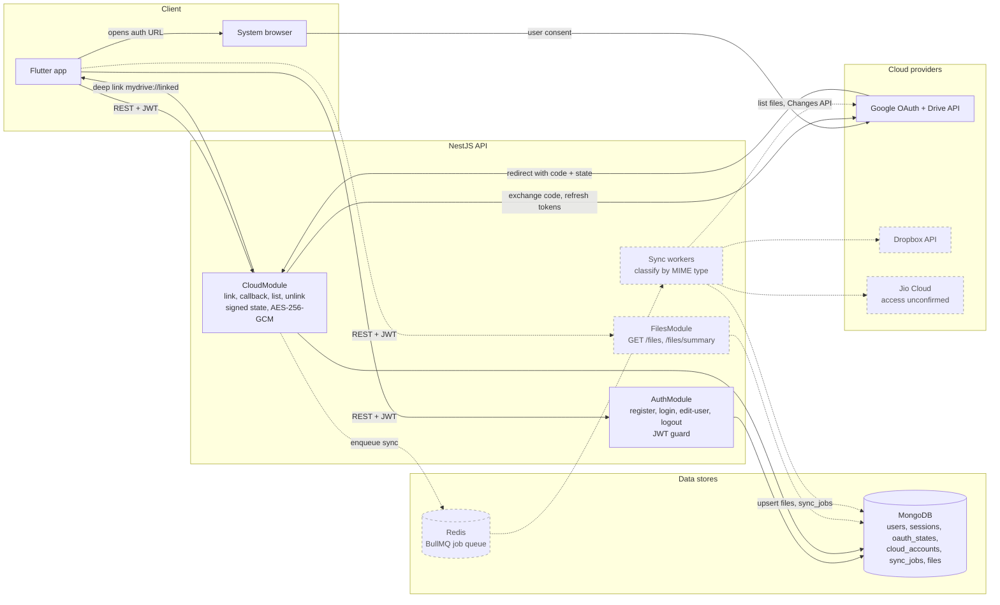
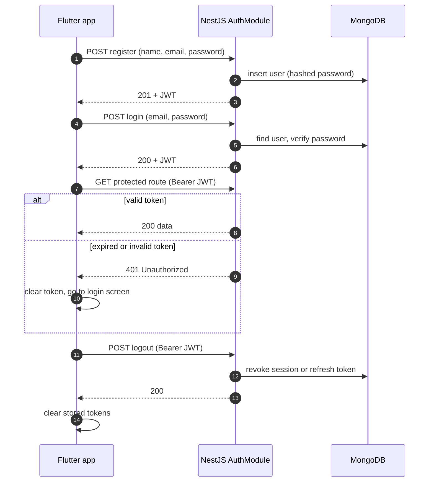
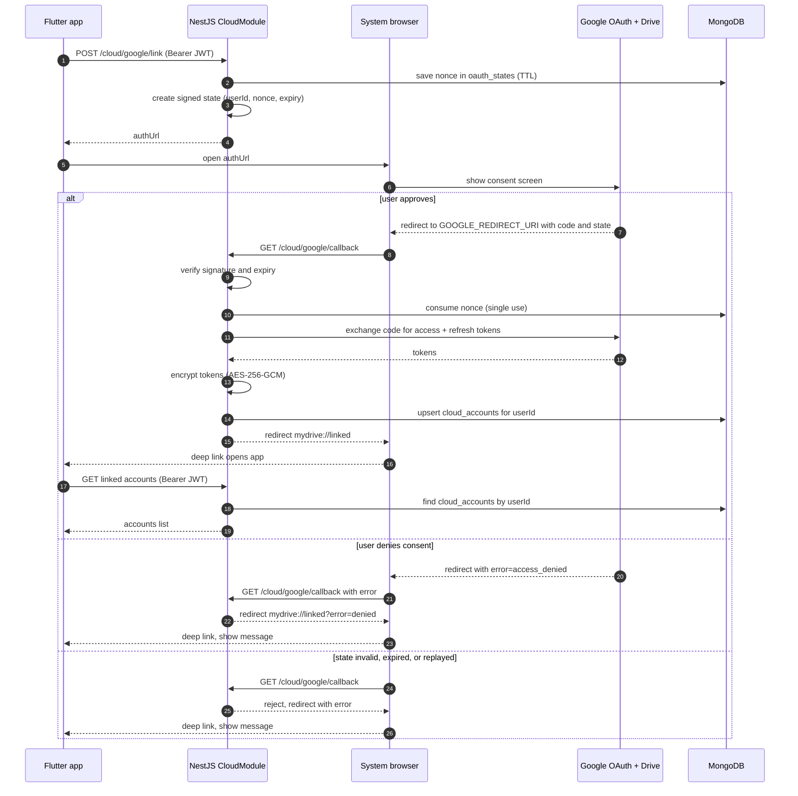
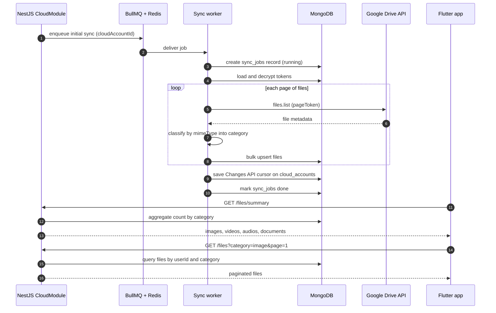
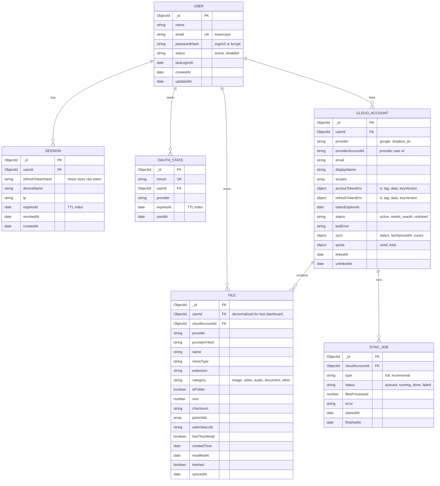

# My Drive: backend diagrams

Dashed items in the architecture diagram and sequence 2c are planned, not built yet.

## 1. Architecture diagram



## 2. Sequence diagrams

## 2a. Register, login, protected call, logout



## 2b. Link Google Drive



## 2c. Sync and classification (planned)



## 3. ER diagram (MongoDB collections)



## 4. MongoDB schema notes

### Collections

| Collection | Purpose | Status |
|---|---|---|
| `users` | Accounts for My Drive | Built |
| `sessions` | Refresh tokens per device, enables real logout and "log out everywhere" | Recommended |
| `oauth_states` | Single-use nonces for the OAuth state, auto-deleted by TTL; replaces the in-memory store and works across multiple instances | Recommended |
| `cloud_accounts` | One linked provider account per record, with encrypted tokens and sync cursor | Built |
| `sync_jobs` | History and status of each sync run, for debugging and showing progress | Planned |
| `files` | One document per provider file or folder, with a normalized category | Planned |

### Indexes

```js
// users
{ email: 1 }                                   // unique, store lowercase

// sessions
{ userId: 1 }
{ refreshTokenHash: 1 }                        // unique
{ expiresAt: 1 }, { expireAfterSeconds: 0 }    // TTL

// oauth_states
{ nonce: 1 }                                   // unique
{ expiresAt: 1 }, { expireAfterSeconds: 0 }    // TTL

// cloud_accounts
{ userId: 1, provider: 1, providerAccountId: 1 }  // unique: no duplicate links
{ userId: 1, status: 1 }

// sync_jobs
{ cloudAccountId: 1, startedAt: -1 }

// files
{ cloudAccountId: 1, providerFileId: 1 }          // unique: safe upserts
{ userId: 1, category: 1, modifiedAt: -1 }        // dashboard by category
{ userId: 1, cloudAccountId: 1, parentIds: 1 }    // folder browsing
{ userId: 1, name: "text" }                       // or Atlas Search for better results
```

### Design decisions

1. **Store `userId` on every file** (denormalized). The dashboard asks "all images for this user across clouds", and this avoids a join through `cloud_accounts`. On unlink, delete by `cloudAccountId`.
2. **Encrypt tokens as sub-documents**: `{ v, keyVersion, iv, tag, data }`. `keyVersion` lets you rotate `CLOUD_TOKEN_ENCRYPTION_KEY` without forcing everyone to re-link.
3. **Never expose** `accessTokenEnc` or `refreshTokenEnc` in API responses. Use `select: false` in Mongoose.
4. **Normalize category once at sync time** (`image | video | audio | document | other`) using MIME type for Google and file extension for Dropbox. Keep the original `mimeType` too.
5. **`parentIds` is an array** because a Google Drive file can have more than one parent, while Dropbox is path-based.
6. **Do not persist Google `thumbnailLink`** as a long-lived URL (it expires). Store `hasThumbnail` and fetch a fresh link or proxy it on demand.
7. **Use bulk upserts** (`bulkWrite`) in sync jobs, keyed on `(cloudAccountId, providerFileId)`.
8. **Unlink flow**: revoke the token at the provider, set `status: "unlinked"`, delete the account's `files`, and delete or anonymize its `sync_jobs`.
9. **Account deletion**: delete `sessions`, `cloud_accounts`, `files`, `sync_jobs`, and `oauth_states` for that user before removing the `users` record.
