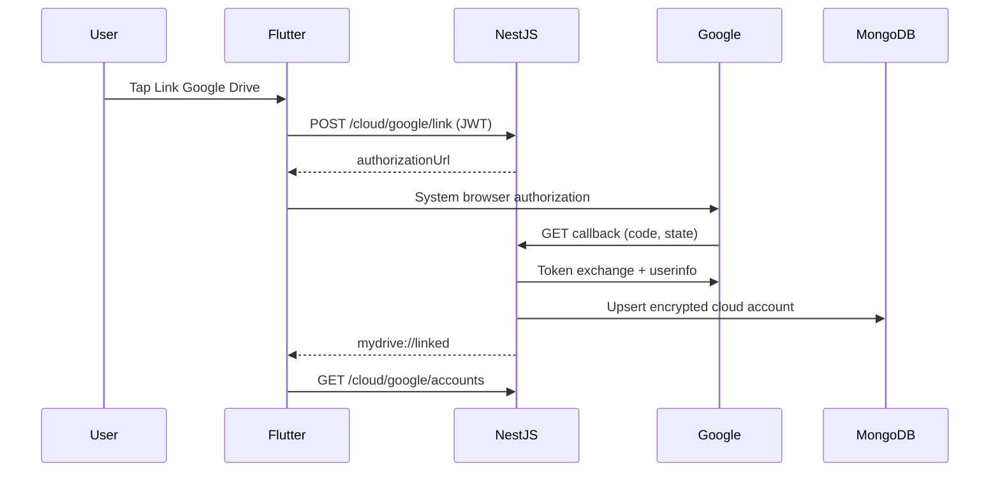
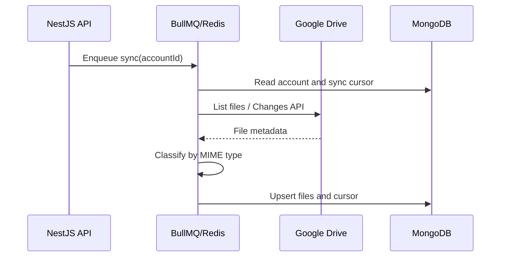

# My Drive User Journeys

## 1. Register

- **ID and name:** J01 — Register
- **Actor and goal:** A new user creates a My Drive account.
- **Preconditions:** The user is not registered; API and MongoDB are available.
- **Trigger:** The user submits the registration form.
- **Happy path:**
  1. Flutter shows the registration form and sends `POST /user/create-user` with `firstName`, `lastName`, `dob`, `gender`, `email`, `phone`, `password`, and `conf_password`. Nest validates the DTO, checks MongoDB for duplicate email/phone, hashes the password, writes `users`, and returns the public user plus JWT.
  2. Flutter stores the JWT securely and shows the authenticated dashboard. No provider data is read or written.
- **Alternate and failure paths:** Invalid fields produce `400`; password mismatch or duplicate email/phone produces `409`; the user sees the form error and remains signed out.
- **Postconditions:** A user exists and Flutter has a My Drive JWT.
- **Security notes:** Password is bcrypt-hashed; password is excluded from public responses.
- **Status:** IMPLEMENTED

## 2. Login

- **ID and name:** J02 — Login
- **Actor and goal:** A registered user starts a My Drive session.
- **Preconditions:** A user exists.
- **Trigger:** The user submits email/phone and password.
- **Happy path:** Flutter sends `POST /user/login-user`; Nest reads the user and password hash from MongoDB, verifies bcrypt, creates a refresh-session record containing only a token hash, and returns a 15-minute access JWT, a rotating refresh token, and the public user; Flutter stores the tokens and shows the dashboard.
- **Alternate and failure paths:** Invalid DTO returns `400`; wrong credentials return `401`; Flutter displays a generic login failure.
- **Postconditions:** Flutter has a 15-minute access JWT and a refresh token.
- **Security notes:** Credentials are sent only over HTTPS. The refresh token is stored hashed in MongoDB and is never logged.
- **Status:** IMPLEMENTED

## 3. Protected API with invalid or expired JWT

- **ID and name:** J03 — Protected API rejection
- **Actor and goal:** A client calls a protected endpoint.
- **Preconditions:** The endpoint uses `JwtAuthGuard`.
- **Trigger:** Flutter sends a missing, malformed, expired, or blacklisted token.
- **Happy path:** Not applicable; rejection is the expected path. The guard checks the bearer scheme, blacklist, and JWT signature before the controller runs.
- **Alternate and failure paths:** Missing bearer token returns `401 Bearer token is required`; revoked token returns `401 token has been revoked`; invalid/expired token returns `401 invalid or expired token`. Flutter clears local auth on a `401` and routes to login.
- **Postconditions:** The protected operation is not executed.
- **Security notes:** The blacklist is process-local and not suitable for multiple instances.
- **Status:** IMPLEMENTED

## 4. Edit user profile

- **ID and name:** J04 — Edit profile
- **Actor and goal:** An authenticated user updates profile data.
- **Preconditions:** A valid JWT and existing user.
- **Trigger:** The user saves profile changes.
- **Happy path:** Flutter sends `PATCH /user/update-user` with optional fields. Nest validates and normalizes values, hashes a new password if present, checks duplicates, updates `users`, and returns the public user. Flutter refreshes its profile view.
- **Alternate and failure paths:** Validation returns `400`; duplicate email/phone or password mismatch returns `409`; unknown user returns `401`.
- **Postconditions:** MongoDB contains the updated profile.
- **Security notes:** Password remains excluded from responses.
- **Status:** IMPLEMENTED

## 5. Logout

- **ID and name:** J05 — Logout
- **Actor and goal:** An authenticated user ends the current session.
- **Preconditions:** Valid JWT.
- **Trigger:** User taps Logout.
- **Happy path:** Flutter calls `POST /user/logout`; Nest adds the presented access token to the in-memory blacklist and revokes all of the user's refresh sessions; Flutter deletes its secure local tokens and shows login.
- **Alternate and failure paths:** Missing/invalid/revoked token returns `401`; Flutter should clear local auth regardless.
- **Postconditions:** The token is rejected by this process and removed locally.
- **Security notes:** No persistent session record exists; restart clears the blacklist.
- **Status:** IMPLEMENTED, limited

## 6. Refresh an access token

- **ID and name:** J06 — Rotate refresh token
- **Actor and goal:** Flutter obtains a new access token without asking the user to log in again.
- **Preconditions:** A valid, unexpired refresh token exists.
- **Trigger:** The access token is near expiry or an API returns an access-token expiry response.
- **Happy path:** Flutter sends `POST /auth/refresh` with `{ "refresh_token": "..." }`; Nest hashes the presented token, atomically revokes that session, creates a replacement in the same family, and returns a new 15-minute access token plus refresh token; Flutter replaces both local tokens.
- **Alternate and failure paths:** Missing/invalid token returns `400`/`401`; expired token returns `401`; a previously rotated token triggers family-wide revocation and returns `401 refresh token reuse detected`; Flutter clears auth and requires login.
- **Postconditions:** The old refresh token no longer works; only the new refresh token is active.
- **Security notes:** MongoDB stores only SHA-256 refresh-token hashes. Concurrent reuse detection revokes the complete family.
- **Status:** IMPLEMENTED

## 7. Refresh-token reuse detection

- **ID and name:** J07 — Reuse a rotated refresh token
- **Actor and goal:** System prevents a stolen old refresh token from maintaining a session.
- **Preconditions:** A refresh token was already rotated.
- **Trigger:** The old token is submitted again.
- **Happy path:** Not applicable; the security rejection is the expected outcome. Nest finds the revoked session, revokes all sessions with its family ID, and returns `401`.
- **Alternate and failure paths:** An unknown token returns `401` without disclosing session details.
- **Postconditions:** The token family cannot refresh again; the user must log in.
- **Security notes:** Reuse detection is server-side and does not depend on Flutter behavior.
- **Status:** IMPLEMENTED

## 8. Link Google Drive

- **ID and name:** J06 — Link Google Drive
- **Actor and goal:** An authenticated user grants My Drive read access to Google Drive.
- **Preconditions:** JWT valid; Google OAuth variables configured; callback publicly reachable over HTTPS; user is an approved Google test user while the app is in testing.
- **Trigger:** User taps Link Google Drive.
- **Happy path:**
  1. Flutter calls `POST /cloud/google/link` with the JWT; Nest creates a signed ten-minute state containing user ID, purpose, and random nonce, stores the nonce in memory, and returns the authorization URL.
  2. Flutter opens the URL in the system browser; Google displays account selection and consent. No database write occurs yet.
  3. Google calls `GET /cloud/google/callback?code&state`; Nest verifies and consumes state, exchanges the code, reads the Google subject from userinfo, encrypts access/refresh tokens, and upserts `cloud_accounts`.
  4. Nest redirects to `mydrive://linked?provider=google`; Flutter returns to the foreground and calls `GET /cloud/google/accounts` to refresh the dashboard.
- **Alternate and failure paths:** Missing config returns a server error; callback state errors return `401`; Google exchange/profile errors fail linking; Flutter shows a link failure.
- **Postconditions:** An active Google account record exists; file records are not yet synchronized.
- **Security notes:** Google tokens remain server-side and encrypted.
- **Status:** IMPLEMENTED

## 9. Google denial, expired state, or replayed state

- **ID and name:** J07 — Link failure states
- **Actor and goal:** A user completes or abandons Google linking safely.
- **Preconditions:** A link URL was generated.
- **Trigger:** User denies consent, waits beyond ten minutes, or retries a callback URL.
- **Happy path:** For denial, Google calls the callback with `error=access_denied`; Nest verifies valid state, consumes the nonce, redirects with an error, and Flutter shows that linking was cancelled.
- **Alternate and failure paths:** Expired, malformed, wrong-purpose, or replayed state returns `401`; no token or account is written. Flutter shows a retry option.
- **Postconditions:** No Google account is linked for the failed attempt.
- **Security notes:** State is checked before processing both success and denial.
- **Status:** IMPLEMENTED

## 10. Link the same Google account twice

- **ID and name:** J08 — Repeat Google link
- **Actor and goal:** A user re-authorizes an already-linked Google account.
- **Preconditions:** Existing `cloud_accounts` record for the user/provider.
- **Trigger:** User taps Link Google Drive again.
- **Happy path:** The normal OAuth flow runs; Nest upserts the `{ userId, provider: google }` record with newly encrypted tokens and active status; Flutter reloads accounts.
- **Alternate and failure paths:** A different user attempting the same Google subject can encounter the provider-account unique index; this should be converted to a stable conflict response in a hardened implementation.
- **Postconditions:** At most one user/provider record exists for the current user.
- **Security notes:** Tokens are replaced, never returned to Flutter.
- **Status:** IMPLEMENTED, with conflict handling to harden

## 11. View linked accounts

- **ID and name:** J09 — List linked accounts
- **Actor and goal:** User views connected providers.
- **Preconditions:** Valid JWT.
- **Trigger:** Dashboard/accounts screen opens.
- **Happy path:** Flutter calls `GET /cloud/google/accounts`; Nest queries `cloud_accounts` by user ID, excludes encrypted token fields, and returns account metadata; Flutter renders status/provider.
- **Alternate and failure paths:** `401` sends Flutter to login; database failure shows retry/error UI.
- **Postconditions:** No provider secret reaches the client.
- **Security notes:** Query is scoped by authenticated user ID.
- **Status:** IMPLEMENTED

## 12. Unlink a cloud account

- **ID and name:** J10 — Unlink Google Drive
- **Actor and goal:** User stops using a linked Google account.
- **Preconditions:** Valid JWT.
- **Trigger:** User taps unlink.
- **Happy path:** Flutter calls `POST /cloud/google/unlink`; Nest sets the matching account status to `revoked`; Flutter removes it from the connected list.
- **Alternate and failure paths:** `401` requires login; missing account currently still returns a success message because the update result is not checked.
- **Postconditions:** Account is marked revoked. Encrypted tokens and any files remain.
- **Security notes:** Google token revocation and data deletion are not implemented.
- **Status:** PARTIAL

## 13. Provider token expired or revoked

- **ID and name:** J11 — Re-link after provider failure
- **Actor and goal:** User restores cloud access after Google invalidates a token.
- **Preconditions:** A linked account exists; sync/token use is available.
- **Trigger:** Provider returns an expired/revoked-token response.
- **Happy path:** PLANNED sync logic detects the failure, refreshes with the encrypted refresh token when possible, or marks the account for re-link; Flutter shows a reconnect action; user repeats J06.
- **Alternate and failure paths:** Current backend has no token decryption, refresh, or sync path, so no automatic recovery exists yet.
- **Postconditions:** PLANNED active token or explicit re-link state.
- **Security notes:** Refresh tokens must never be sent to Flutter.
- **Status:** PLANNED

## 14. Initial sync and classification

- **ID and name:** J12 — Sync cloud files
- **Actor and goal:** System imports file metadata and categories.
- **Preconditions:** Active cloud account and BullMQ/Redis workers.
- **Trigger:** Successful link or scheduled/incremental sync.
- **Happy path:** PLANNED worker reads encrypted provider credentials, lists Google Drive files, classifies MIME types, upserts `files` by cloud account/provider file ID, and stores a change cursor for incremental sync.
- **Alternate and failure paths:** Provider rate limit/network failure retries with backoff; revoked access marks the account and notifies Flutter; malformed metadata is logged without tokens and isolated.
- **Postconditions:** `files` contains searchable metadata.
- **Security notes:** User ownership must be checked for every file query and job.
- **Status:** PLANNED

## 15. Browse dashboard by category

- **ID and name:** J13 — Browse images, videos, audios, documents
- **Actor and goal:** User browses normalized files.
- **Preconditions:** Initial sync completed and file endpoints exist.
- **Trigger:** User selects a category.
- **Happy path:** PLANNED Flutter calls `GET /files?category=image&page=1` or the corresponding category; Nest scopes by user/account and queries the indexed category/modifiedAt fields; Flutter renders paginated results.
- **Alternate and failure paths:** Invalid category/page returns `400`; no results renders an empty state; sync delay shows a loading/last-synced state.
- **Postconditions:** User sees files grouped by category.
- **Security notes:** Never trust a client-supplied account ID without ownership validation.
- **Status:** PLANNED

## 16. View or download a file

- **ID and name:** J14 — Open file
- **Actor and goal:** User views or downloads a cloud file.
- **Preconditions:** File metadata exists and provider access is active.
- **Trigger:** User taps a file.
- **Happy path:** PLANNED API verifies ownership and either streams through Nest or returns a short-lived provider URL; Flutter opens/downloads it.
- **Alternate and failure paths:** Missing file returns `404`; provider access failure returns a re-link-required response; expired short-lived URL is regenerated.
- **Postconditions:** File is viewed/downloaded without exposing long-lived tokens.
- **Security notes:** Use short-lived URLs, authorization checks, content-type/size controls, and audit logs.
- **Status:** PLANNED

## 17. Link Dropbox and Jio Cloud

- **ID and name:** J15 — Add future providers
- **Actor and goal:** User connects additional storage providers.
- **Preconditions:** Provider OAuth/API partnership and adapter are available.
- **Trigger:** User taps a future provider card.
- **Happy path:** PLANNED provider-specific link flow implements the same interface: authorize, callback, encrypted credentials, account record, sync job, and classified files.
- **Alternate and failure paths:** Dropbox extension-based classification is needed because MIME types are not reliable; Jio Cloud public self-serve end-user API feasibility is currently unconfirmed and may require a partner/enterprise agreement.
- **Postconditions:** Provider account and files are available if supported.
- **Security notes:** Provider client secrets and tokens remain backend-only.
- **Status:** PLANNED

## 18. Delete account and stored data

- **ID and name:** J16 — Delete account
- **Actor and goal:** User permanently deletes My Drive data.
- **Preconditions:** Authenticated user and confirmed destructive action.
- **Trigger:** User confirms account deletion.
- **Happy path:** PLANNED endpoint verifies JWT and confirmation, deletes `files`, revokes/deletes cloud accounts and encrypted tokens, then deletes the user and invalidates sessions.
- **Alternate and failure paths:** Confirmation/authorization failure returns `400`/`401`; partial deletion must be retried through an idempotent cleanup job.
- **Postconditions:** My Drive data is removed; provider data is not deleted unless explicitly supported and authorized.
- **Security notes:** Use an audit record, transactional/outbox cleanup strategy, and never log tokens.
- **Status:** PLANNED
